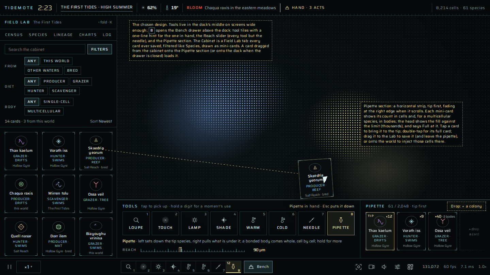
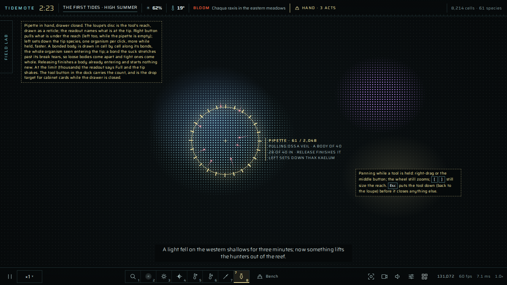
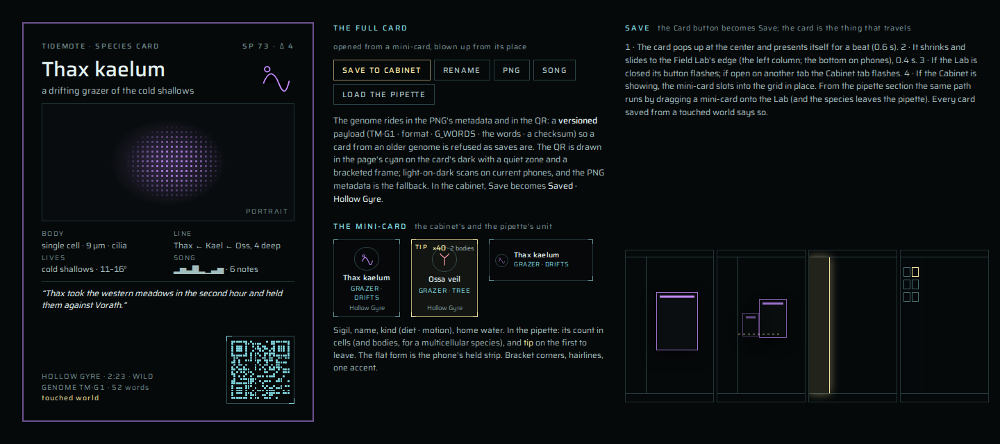
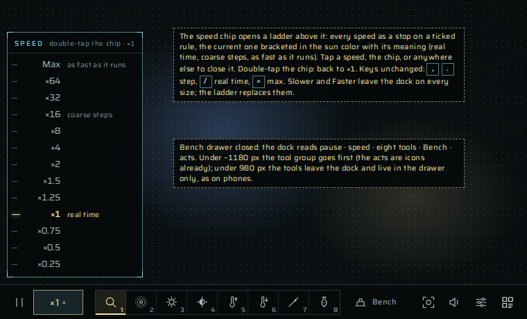
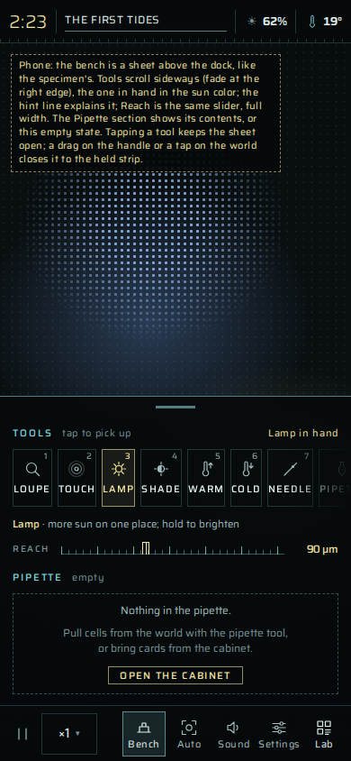
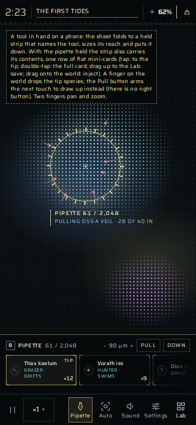
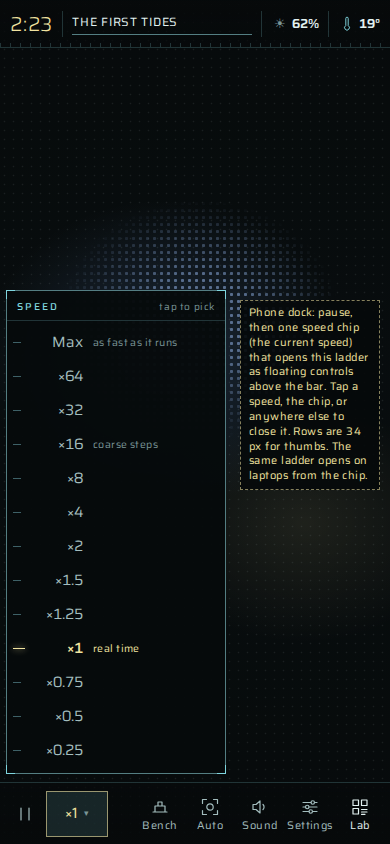
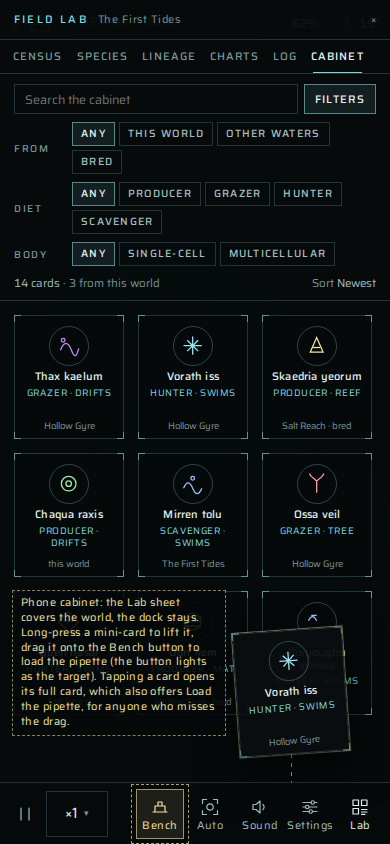
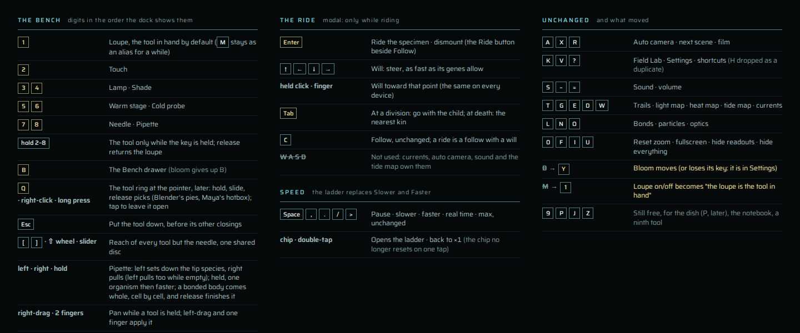

# A hand in the world: interaction for Tidemote, 2026-10-27

A brainstorm in the spirit of docs/next-level-2026-10-20.md, on one question that document set aside as
"a decision for the owner" (its option 23): how a viewer could have a hand in the simulation without
cheapening it. Today the page is a thing to watch, inspect and name; the one act on the world is Settings →
Pool events → Start one now. What follows is a field of options, a diagnosis of what would and would not fit,
and six avenues developed in depth with rule sketches, what each needs from the code, and what could go
wrong. A brainstorm to be screened, not a plan already decided; what has since been decided is marked *Decided* with
its date, and the interface chosen for the hand is in 4.8. *Built (2026-10-28):* the bench, the ride, the pipette and the
cabinet, with the interface of 4.8; docs/hand.md says how, and where they differ from this plan.

**The stance, restated.** Every ecological rule is local; nothing census-driven steers the ecology; matter is
conserved; energy enters only as light. The gate stays the floor. Interaction has to live inside that, or it
is a different project.

---

## 1. What a hand could be

The worry in the request is the right one: a Spore-like loop of levels and upgrades, bolted on, would turn a
biosphere into a toy. The way through is to ask not "what can the player do" but "who is the viewer, in the
world's own terms". The page already answers half of it: the view is a microscope, the Lab is an instrument
bench, the chronicler is an old naturalist. The viewer is the person at the microscope. Five roles follow,
each a kind of hand the world already knows:

| The viewer as | What the hand is, in the world's terms | Already there |
| --- | --- | --- |
| **the weather** | a global boundary condition: an era, a drought, a storm | Pool events, Start one now |
| **the microscopist** | a local physical cause under the objective: a lamp, a heated stage, a needle, a pipette, a stir | nothing |
| **an organism** | one cell's will among its drives, as fast as its genes allow, as hungry as its upkeep | the specimen panel's mind view (read-only) |
| **the founder, the breeder, the vector** | abiogenesis with a plan, selection with a purpose, a current between worlds | names (`sp.given`), `.tidemote` saves, species cards |
| **the witness** | a commitment that costs nothing in the world and everything in attention: a name, a wager, a vigil, a note | names, Film, cards |

The one principle that runs through everything below: **the hand does nothing the world cannot do by itself.**
A stir is a storm's gust, a lamp is a band of the tide, a heated stage is a pile of framboids, a needle is a
hunter, a pipette is a current and a drought's isolation, a dike is a low-water era, an inoculation is a spark
of abiogenesis, breeding is selection. That rule keeps every tool local and honest, it keeps the gate's
world untouched (the headless tools never see a hand), and it lets the chronicler describe what the hand did
with the vocabulary it already has.

---

## 2. What would cheapen it

Named first so the options can be screened against them.

- **Scores, counters, currencies, achievements, progress bars.** The world has rewards already: the chronicler's
  lines, the lineage view, a name that sticks, a card. Interaction should feed those and add nothing else.
- **Powers.** A hand that makes energy from nothing, kills by the thousand, or acts in a frame. Tools should be
  the size of the loupe, as slow as the world (a lamp warms a meadow over a minute; its effect on the food web
  unfolds over ten), and bounded by physics rather than by rules (a pipette holds a dozen cells because it is a
  pipette, not because a limit says so).
- **Regulators.** "Favor this species", "protect that guild", "make hunters rarer": anything whose input is a
  census. The founding doc's lesson (isolation, not die-off, makes diversity) is the model: a hand works by
  changing *where* and *under what light* life lives, never by setting its numbers.
- **A loop that takes attention away from watching.** The test for any tool: after an hour with it, does the
  viewer still spend most of the hour looking? A microscopist does. A player of a build-and-upgrade game does
  not.
- **A hand nobody records.** If the world can be touched, its record must say so, or saves and cards lose their
  meaning as natural history. A touched world is marked (a save's provenance, a card's "kept" against "wild");
  the chronicler notes the hand's acts as it notes the weather.

---

## 3. The field of options

Each in a line or two. "Strong" marks the ones developed in section 4.

| | Option | Note |
| --- | --- | --- |
| **The weather** | | |
| 1 | Start an event now | built (docs/catastrophes.md) |
| 2 | Choose the next era, its warmth and light, or the water's resting level | boundary conditions; a "Climate" dial in Settings; cheap, fine, dull alone |
| 3 | Found a world by hand: founders, colonies, aspect, water level, the seed of its music | initial conditions; cheap; the natural home for 4.4's cabinet |
| 4 | Physics (`K`) exposed in the page as a Sandbox tab, the world then marked "altered" | for experimenters; the headless tools already take `--k`; keep it out of the ordinary page |
| **The microscopist** | | |
| 5 | Touch the water: a tap is a drop's ring, a drag a stir | **strong** (4.1), nearly free: `drops` in `flowAt` exist |
| 6 | The lamp: a disc of light at the pointer; its shade: a disc of dark | **strong** (4.1); one term in `tideAt` |
| 7 | The heated stage and the cold probe: heat deposited into `b.thermal` under the pointer | **strong** (4.1); the framboid deposit is the template |
| 8 | The needle: kill one cell (a husk stays), cut one bond, prod one body | **strong** (4.1); a per-frame act uniform |
| 9 | The pipette: draw up a few cells or grains, carry them, drop them | **strong** (4.1); the pick pass lists the ids; a small write pass moves them |
| 10 | Mud and stone: raise or dig the floor; drop a grain of stone | 4.7; the relief must then be saved (it is regenerated from the seed today) |
| 11 | The lamp under the loupe, always: wherever you look, a little more light | the gentlest form of 6, a setting; "observation changes the observed" |
| **An organism** | | |
| 12 | Ride a cell: the camera follows, the sound comes close, the panel shows its mind | half built (follow, `jump`, the mind view) |
| 13 | Steer a cell: a will among its drives, bounded by its genes | **strong** (4.2) |
| 14 | Hop at a division: stay with the mother or go with the child; hop to kin at death | **strong** (4.2); descending a lineage one life at a time |
| 15 | Choose the child's mutation at a division ("level-ups") | the Spore loop; in-world it is a shop; moved to the dish (4.3) where it is selection |
| 16 | Steer a body: the ridden cell's will moves the body it is bonded into | falls out of 13 (bonds pull both ways) |
| **The founder, the breeder, the vector** | | |
| 17 | The culture dish: a small still world on the bench, cells pipetted in and out, light and warmth set by hand | **strong** (4.3) |
| 18 | Breed in the dish: keep or cull each child; ask for a brood of mutants and pick one | **strong** (4.3); mutations are the GPU's own distribution (`mutateLike`) |
| 19 | Design a species from an archetype, in the ecology's own words, portrait and song live | **strong** (4.3); the viewer's first idea |
| 20 | Evolve a species from an existing one: design starting from its genome, parent set | **strong** (4.3); the viewer's second idea |
| 21 | Inoculate: release a designed or bred species into the world as a directed spark | **strong** (4.3) |
| 22 | Cross two species by hand (the dish's hybrid): recombination that exists only on the bench | interesting; a lineage with two parents breaks the tree view; later |
| 23 | Species cards carry their genome; a card dropped on any world inoculates it | **strong** (4.4); a social loop with no server |
| 24 | The cabinet: species you have carded, wild or bred, with their native world; found new worlds from it | **strong** (4.4) |
| 25 | A lineage carried across worlds: its record says where it has been | **strong** (4.4); the viewer as the vector between sealed worlds |
| **The witness** | | |
| 26 | Wagers: "I expect Thax to outlast this era"; the chronicler answers when it resolves | **strong** (4.5); zero ecology |
| 27 | Vigils: watch a species; its song chimes and the camera goes when something happens to it | **strong** (4.5) |
| 28 | A field notebook: the viewer's notes pinned to a time and place, interleaved with the chronicle, kept in the save | **strong** (4.5) |
| 29 | Pressed specimens: a moment of the view kept with the save, revisited | 4.5 |
| **The experimenter** | | |
| 30 | Every act with a control: fork before touching, compare the twins | **strong** (4.6); the previous doc's 4.6 with a reason |
| 31 | Headless hands: `--hand '[{"lamp":...}]'` plans for ensembles, to size the tools | 4.6 |
| 32 | A press of the world (a bookmark in RAM) to return to and try another hand | 4.6; `snapshot()` exists |
| **Set aside** | | |
| 33 | Compose a species from its song (the motif inverted) | a curiosity; the map is many-to-one |
| 34 | Sketch a cell's outline and get the nearest shape family | cosmetic |
| 35 | Two viewers in one world | needs a shared engine; not this year |
| 36 | A sound the cells answer | the soundtrack is observational; keep it so |

---

## 4. The strongest avenues

### 4.1 The bench: the microscopist's tools

**Why.** The page's own metaphor, taken literally. A microscopist does not only look: there is a lamp with a
diaphragm, a heated stage, a dissecting needle, a micropipette, and a fingertip on the slide. Each is a local
physical cause of a size the objective covers, each has a natural twin the world already does to itself, and
each produces consequences that unfold at the world's pace, which is what makes it gardening rather than a
game. A second reading of the same tools is the aquarist's (light, heat, stock moved, the dead removed), which
is the hobby most people would recognize the page as, once it has hands.

**The tools.** The loupe is the first of them and the one in hand by default; picking another stops the auto
camera and turns the loupe's disc into the tool's reach, drawn as a reticle. Where they live, what the hand
does on a phone, and the keys are decided in 4.8.

- *Touch.* A tap makes a drop's ring wave; a drag stirs the water along the stroke (a transient vortex pair
  added to the stream function, decaying over a few seconds). A crowd scatters, a patch's grazers are carried
  into the next, a hard stir breaks bonds past `bondBreak`. The ring is `drops` in `flowAt` with the pointer as
  its source. An afternoon, and the first thing a phone can do to the world.
- *Lamp and shade.* A disc of extra light at the pointer, `lampGain` × a Gaussian falloff, added where
  `tideAt` is read: photosynthesis in `lifeMain`, the sparks, the light map; the phototaxis slope gets the
  Gaussian's gradient. Held, it brightens over a second; released, it fades over ten. Producers bloom under
  it, phototactic cells gather, a sustained lamp makes a meadow that grazers find and hunters then haunt. The
  shade is the same term negative (the duckweed's mechanism, by hand). Energy enters as light already; the
  lamp is more sun on one place.
- *Heated stage and cold probe.* Heat deposited into `b.thermal` under the pointer each step, like a framboid
  pile; or drawn out, like a cold snap on one spot. Thermal specialists move, torpid cells wake, a warm pocket
  carries a lineage through a frost. Heat is a medium life reads, so everything downstream is already built.
- *Needle.* One cell dies under the tip (a husk, matter conserved); a bond is cut (a body becomes two
  organisms, docs/tissue.md); a body is prodded. A per-frame act uniform (`act`, `actId`) that `lifeMain`
  honors for that id only. The viewer as one more hunter, one kill at a time.
- *Pipette.* Draw up the cells within the reach (the pick pass already lists them), bodies whole, carry them
  (the drawer shows them as cards with counts, 4.8), drop them elsewhere one at a time or in a stream, or load it from
  a cabinet card (4.4) and set a species down in a world that never had it. A small write pass sets positions
  and zeroes velocity; stretched bonds break as they do. Dropped into empty water they are a pocket, and
  docs/founding.md says pockets are where diversity comes from: the pipette is the transplant, and the one tool
  that can make a world richer rather than poorer.

**What the world says back.** The chronicler receives the hand's acts (tool, where, when, the ids under the tip)
as it receives the climate's events, and writes them in the third person, as weather: "a light fell on the
western shallows for three minutes; Thax kaelum bloomed under it and the grazers of Vorath found them."
*Decided (2026-10-27):* the voice stays the one it has, the old narrator who has seen many worlds; it never
says "you", and the hand is described as it describes a storm. The narrator may allow itself a wry line
about the hand ("someone has been at the lamp again"), rarely: at most once an hour, under the same budget
as every other story (`TUNE`), and never two in a row. The
director's captions and the survey already follow births and kills, so the camera will go where the hand's
consequences are without being told.

**Storage and cost.** Uniforms for the lamp, the stage and the act; the pipette's write pass; a hand log in the
page's record (saved, so a reloaded world knows it was touched). Nothing in the genome, nothing in the gate.

**Risk.** A lamp held for an hour is a regulator by other means; the falloff and the reach are the limits, and
holding it is the viewer's time. The stir must not fuse strangers' bodies (the bond-back pass already refuses).
On phones the bench competes with the specimen sheet for the dock; 4.8 gives it the same sheet idiom and one
button.

### 4.2 Riding a cell

**Why.** The viewer's own big idea, and the one that puts them *inside* the drama the chronicler reports from
outside: hunger, hunters, warmth, the song. The parts exist: the camera can follow a cell, the sound brings the
followed species close, `WATCH_WGSL` finds a cell by id every frame, and the mind view already decomposes
exactly the vector sum a will would join. What makes Spore's cell stage a game is the shop and the scorecard.
Take the ride, leave the shop.

**The rule.** A cell has no brain; each step it sums pulls and pushes (appetite, fleeing, kin, personal space,
bonds, schooling, warmth, light) and goes where the sum points. Riding adds one more term, `will`, for one id:

- A `pilot` uniform (id, target point, strength 0..1). In `cellWGSL`'s force sum, for that id only,
  `will = strength × g.swim × g.force × unit(target − pos)`, subject to everything swimming is subject to:
  drag, thermal performance, torpor, stranding, the shore's drag. The will's thrust costs upkeep as swimming
  does, so a cell steered without rest starves. A reef cannot be steered (`swim` 0); a tree with a beat is
  steered as fast as its beat allows; a cell bonded into a body pulls the body, since bonds pull both ways.
- Nothing else changes. It eats when it is hungry and near food it is built for, divides when it can, misses
  what it does not recognize, flees what it fears (the viewer's will and its fear can disagree, and the panel
  shows both). The viewer cannot bite, divide or heal on command.
- The specimen panel gains a *Ride* button beside Follow (Enter) and a *Will* row among the drives, its
  compass showing the will against appetite and flight. The will's target is the arrow keys, a held click, or
  a held finger on a phone (the same on every device; W A S D stay what they are: currents, the auto camera,
  sound and the tide map). The camera follows; the sound comes close. Steering is offered only at ×2 or below
  (coarse steps cannot be steered); at higher speeds the ride continues as a follow.
- At a division: stay with the mother or go with the child (Tab). At death: the panel says how it died,
  as the captions do today, and offers the nearest kin or the latest child. Over an hour the viewer has walked
  down the tree of life one life at a time; the Lab's lineage view marks the line they rode. The ride ends when
  the last kin dies: an extinction witnessed from inside.

**Guided evolution, without a menu.** Where the viewer takes a cell is a selection pressure. A grazer steered into
the warm shallows breeds there and its children are born there; a line ridden for ten generations toward the
light adapts to the light, by the GPU's own mutation and selection, not by a chosen trait. That is the whole
of "guided evolution" in the world; choosing mutations belongs on the bench (4.3), where it is honest
artificial selection rather than a shop.

**What the chronicler says.** The ridden species joins the `SPL_WATCH` list. One story kind, `ride`, rarely:
"the cell that was steered along the reef lived four minutes and divided twice; its line is thirty strong
now", and, in the obituary of a ridden lineage, that it was ridden.

**Cost.** One uniform and a branch on id in `lifeMain` (negligible), the panel row, the keys, the pacing rule,
the lineage mark. The largest part is the feel: the will's gain, the dead zone around the pointer, the ease of
the camera, the hop at division. A few days.

**Risk.** Registers in `lifeMain` (one more branch; keep it beside the `selId` reads). A ride that feels like a
joystick and a cell that feels like a vehicle: the will must be one drive among several, visibly losing to
hunger and fear at times, or the vibe is gone.

### 4.3 The culture dish: breeding, design and inoculation

**Why.** The viewer's first two ideas (design a species; evolve one from an existing species) and the right home
for the third's "choose the mutation". Darwin opened the *Origin* with pigeon fanciers: selection by hand is
how the argument for selection by nature was first made legible, and it is the one form of "guided evolution"
that is biology rather than a shop. The Field Lab is already called a lab; `tools/swimlab.mjs` and
`tools/species-portraits.mjs` already build one body alone in still water.

**The bench.** A small second engine (a few thousand particles, still water, no eras) drawn in a Lab tab as a
petri dish: its light, warmth and silt set by hand, a few prey or husks pipetted in if the culture needs them.
Three things happen there:

- *Culture.* Cells pipetted from the world live in the dish under conditions the viewer sets; the specimen
  panel and the mind view work there as they do in the world. The pipette takes them back.
- *Breed.* Each division in the dish shows the child's mutation in words (the genome tab already compares a
  species with its nearest ancestor: "a little faster, a little less tolerant of cold"); the viewer keeps or
  culls with the needle. Or asks for a *brood*: eight mutants of one cell drawn on the CPU by `mutateLike`
  (which mirrors the GPU's `mutateInto`, rare structural rewrites included), each shown as portrait, sigil,
  song and description, one chosen to culture. Nothing bred this way lies outside what evolution could make;
  the viewer supplies only the selection.
- *Design.* A new species from an archetype, in the ecology's own words: the diet triangle, body plan (the
  twelve families, tissue or tree, growth plan), thermal niche, speed, lifespan, adhesion, calcification, beat,
  phototaxis, heat-making. A dozen dials; the other genes derived by `archetypeGenome`'s own ranges;
  signatures drawn at random, or inherited when designing *from* an existing species (its genome the starting
  point, its serial the parent, so the lineage view shows the branch). Portrait, sigil, song and `describe`
  update live. The dish runs the design alone for thirty seconds to show whether it can live (photosynthesize,
  swim, grow a body): swimlab's readout, in the page. It cannot be made fitter than the trade-offs allow,
  because the trade-offs (`photoPow`, mixed diets that earn little, catching that takes skill) are in the
  kernel, not the genome. Most designs will die in the world within minutes, as most sparks do. That is the
  lesson, and the dish lets the viewer learn it before releasing.

**Inoculation.** Release is a directed spark: the genome written to a free species slot (the path sparks of
abiogenesis use to found a lineage), a few silt grains under the pipette's tip turned into cells of it, exactly
as abiogenesis turns silt into a new line. The registry gains two origins beside founder, spark and mutant:
*inoculated* and *returned* (cultured cells put back). The chronicler: "a new line, set down in the eastern
shallows by a hand, has lasted ten minutes among the grazers"; and, more often, its obituary.

**Storage.** A second `Engine` at dish scale (memory is small; the fork tool runs two headlessly already) with
its own registry; a genome-transfer path between engines (CPU genomes, `writeGenome`); the slot allocation
sparks use, called with a given genome. The design dials are a mapping, not new genes.

**Risk.** The dish is the largest piece here (a second engine in the page, a new Lab tab, a pipette between
worlds). The design UI could become fifty sliders; it must stay a dozen words. Slot exhaustion if a viewer
inoculates hundreds of lines (the registry's slot reuse handles dead ones). Bred species that are tuned to a
dish's still water and die in the current, which is correct.

### 4.4 Carrying species between worlds: cards as seeds, the cabinet

**Why.** Nothing in a world persists past its tab except a `.tidemote` file, and species are the unit people
care about (they name them; the card exists for them). If a species can leave a world, the viewer becomes the
vector between sealed worlds, which is what ballast water, birds' feet and a gardener's cuttings are, and the
world of the day (the previous doc's 4.6) gains a currency that is a lineage rather than a save.

**The rule.**

- A species card carries its genome: a text block in the PNG's metadata and a QR in its corner (52 words is a
  few hundred bytes). The payload is versioned (`TM·G1`, then `FORMAT`, `G_WORDS`, the words, a checksum) so
  a card from an older genome is refused as an old save is, and the QR is drawn in the page's cyan on the
  card's dark, with a quiet zone and a bracketed frame, in the page's own look rather than a black square.
  Dropping a card on any world (the cabinet, or a PNG dropped on the page) makes it a seed the pipette can set
  down (4.8), its record saying where it came from: "carried from the Hollow Gyre, where it reigned forty
  minutes". A card pasted into a phone's world from a laptop's screen is the whole social loop, with no server.
- The cabinet is a Field Lab tab (not a settings panel: it is the viewer's collection), the store of every card
  ever saved, each with its native world and era, wild or bred (and in which dish); its filters are the
  Species tab's, its items are mini-cards; 4.8 has the rest. Starting a world may draw its founders from the
  cabinet (the founding's 48 colonies filled from chosen species, with the usual share of random sparks), so a
  viewer can found a world from lineages they have followed for weeks.
- A lineage's record follows it across worlds: the card's line of descent begins in the world where it was
  born, and the chronicler in a new world knows it is a stranger ("the Thax line, from another water, has
  taken the eastern meadows").

**Cost.** The card's metadata and QR (a few hours), the cabinet tab and the mini-card (a day or two, modeled
on Species), the Save animation, founders-from-cabinet in `seed`, the registry's cross-world origin. With the world of the day: a species many viewers carry becomes
a shared character, and the daily summary can count how many worlds it took.

**Risk.** A card from a world with another `FORMAT` or `G_WORDS` (reject, as saves do). Designed species traded
as "wild" (the provenance travels with the genome, and the card says bred).

### 4.5 Wagers, vigils and the notebook

**Why.** The cheapest avenue and the only one that changes nothing in the world at all; the witness's hand is
attention, committed. A viewer who has said "I expect the reef to fall" watches differently, and the world
answering in the chronicler's voice is engagement without power: Gould's question, made personal.

**The rule.**

- *Wagers.* In the specimen panel: "I expect this species to outlast the era / to reach a tenth of the world /
  to be gone within twenty minutes". The chronicler answers when it resolves, in its voice ("you had Thax
  kaelum surviving the Bitter Hush; it did not; its last cell froze in the northern shallows") and the record
  keeps the viewer's calls over a world's life, never as a tally, only as entries.
- *Vigils.* Watch a species: its song chimes and the camera goes when the chronicler has something to say about
  it, or when it crashes, booms or dies; the specimen panel's pin is the control.
- *The notebook.* A Lab tab for the viewer's own entries, each pinned to the world's time and the camera's place
  (the auto camera's bookmarks already do this for shots), interleaved with the chronicle and kept in the save.
  Pressed specimens: a frame of the view at a moment, kept with the entry. The viewer's natural history beside
  the chronicler's.

**Cost.** CPU only: the chronicler gains a wager resolver and a story kind; the Lab a tab; the save a list.

**Risk.** Drawn wrong, wagers look like a betting app. They are written as a naturalist's expectation ("I expect
..."), resolved in prose, never scored, never counted.

### 4.6 Every act with a control

**Why.** A hand that cannot be compared with its absence teaches nothing; it only feels powerful. The previous
doc's fork (two engines from one state, side by side, one camera) gains a purpose here: *fork before touching*.
The twin runs on untouched; after ten minutes the chronicler compares ("in the lit world Thax took the meadow;
in the dark one it was eaten out"). Then *Keep* one. This is the microscopist's stance, and the thing that
makes the tools an instrument rather than a toy.

**Also.** A press of the world (`snapshot()` in RAM, one or two at page scale) to return to and try another hand.
And headless hands: a `--hand '[{"lamp":{"at":300,"x":..,"r":..,"s":600}}]'` plan for `sim.mjs` and
`ensemble.mjs`, modeled on `eventPlan`, so a tool's strength can be sized across seeds: a lamp should matter
to the place it lights and not reshape a 32k world alone. The gate itself never runs with a hand.

**Cost.** The fork is the previous doc's cost (two engines, a world index in the census and the registry); the
press is small; the hand plan is a day.

### 4.7 Smaller pieces worth carrying along

- **Mud and stone.** Raise a dike or dig a channel under the pointer (the relief field in thermal block 3, drawn
  bicubically); drop a grain of stone (a silt grain made `STONE`, which calcifiers then settle on). A dike is a
  divider the next low-water era or drought turns into a wall between pools: the viewer makes the islands
  founding.md found so fruitful. Needs the relief kept in the save (`restore` rebuilds it from the seed today):
  a `FORMAT` bump.
- **The lamp under the loupe.** A setting, off by default: wherever the viewer looks, a little more light.
  The gentlest hand, and a screensaver that answers to being watched.
- **Founding by hand.** Settings → New world: founders (from the cabinet or the archetypes), colonies, aspect,
  water level. Initial conditions, which the previous doc already allowed.
- **A Sandbox tab** for `K`, for the curious, the world then marked "altered" everywhere its record goes.
- **Hybrids on the bench.** Two genomes crossed in the dish, gene by gene with the GPU's own mutation after.
  Recombination that exists only by hand, so the world's rules do not change; the lineage view would need a
  second parent.

---

### 4.8 The interface, decided (2026-10-28)

Four directions were drawn and judged on discoverability, what they cost the world view, phone parity, room
for the pipette's contents and the cabinet, and build cost: a Photoshop-style tool strip at the stage's edge,
the tools in the dock, a ring at the pointer, and a drawer above the dock. The edge strip fights Safari's edge
swipes and the specimen sheet on phones and gives the two sizes two mental models; the ring alone is
undiscoverable; the drawer alone hides the tools behind a button. The choice is **the dock and the drawer**,
with the ring to come later for power users. The boards are on the design canvas
(https://claude.ai/artifact/B3SQejEmXVw8kA25seo12v, the rows titled *Final*) and rendered in `docs/mockups/`.
Everything below keeps the page's look (hairline rules, tick strips, bracketed corners, one accent for what is
in hand, the reticle for what the hand reaches).

**Where the tools live.**

- The dock's middle, empty today on laptops, holds the eight tools as one numbered group in the order of
  their keys: Loupe, Touch, Lamp, Shade, Warm, Cold, Needle, Pipette, with a **Bench** button beside them.
  The one in hand is in the sun color; the pipette's button carries its count. Below about 1180 px the tool
  group comes first and the acts (Auto, Film, Sound, Settings, Lab) are icons; below about 980 px, and on
  phones, the tools leave the dock and live in the drawer only.
- **The Bench drawer** (**B**, or the Bench button) rises above the dock, the same idiom as the phone's
  specimen sheet: tool tiles (icon, name, key) with a one-line hint for the tool in hand; the **Reach**
  slider; the **Pipette** section. The drawer never holds a setting; Settings and the Lab are untouched apart
  from the Cabinet tab and the Save button (below).
- The loupe is tool 1 and the tool in hand by default (M stays an alias for a while). Picking another turns
  the loupe's disc into that tool's reach, drawn as a reticle: a ticked ring, a center cross, a small readout
  that names the tool and what is under it ("Pipette · 7 / 12 · pulling Vorath iss ×3"). On phones, where the
  loupe is off today, tool 1 is tap-to-examine.
- Esc puts the tool down (the loupe returns) before it closes anything else. Holding a digit is a quasimode:
  the tool for as long as the key is held, then the loupe again. Right-drag or the middle button pans while a
  tool is held; the wheel still zooms. Picking a tool up stops the auto camera.
- The rail gains a *Hand* chip beside the event chip once the world is touched (the provenance of 4.1), and the
  chronicler's captions report the hand as weather.

**Reach.** One slider in the drawer, under the tiles, is the effect radius of every tool but the needle, which
is always a point. It is a world distance (shown in µm on the slider and in the reticle's readout), the same
for all tools, saved with the page's prefs. With a tool other than the loupe in hand, `[` `]` and ⇧ wheel
move the same value; with the loupe in hand they magnify, as today. Its range is sized with the headless hand
plan (4.6): a lamp at full reach should matter to the place it lights and not to a 32k world.

**The pipette.** A stack of cells with a limit in the thousands (`pipetteMax`, 2,048 to start, sized so a
reef's worth fits and a world's worth does not), shown in the drawer's Pipette section as a strip of
mini-cards, one per species, each with its count in cells and, for a multicellular species, in bodies,
scrolling sideways and fading at its right edge when there is more. The first cells in go to the back; the
last are at the tip. For simplicity the cells sort by species, and the species are ordered by when their
first cell entered, so the strip reads tip first: the left-most card is the species that leaves next. Tapping
a card brings it to the tip (it becomes the left-most and is highlighted); double-tapping opens its full card.
The unit the pipette moves is the **organism**: a cell, or a body of bonded cells, which stays bonded in the
pipette and comes out bonded.

- *Pulling.* With the pipette in hand, the right button pulls what is under the reach, one organism per
  click; held, one, then a second, then a third, each sooner than the last. While the pipette is empty the
  left button pulls too. A body is drawn in progressively, cell by cell along its bonds from the cell nearest
  the tip (a breadth-first walk of the bond graph, one ring of neighbors per few ticks), the whole organism
  seen entering the tip. A bond holds unless the suck is stronger than it: the draw is a force on each cell
  toward the tip, and a bond stretched past `bondBreak` by it breaks as any bond does, so a loose body tears
  and only the near part comes, while a tight one comes whole, however many cells, even past the twelve a
  single click was once imagined to carry. Releasing the button finishes what has begun (a body partly in
  keeps coming until it is all in) and starts nothing new. The animation is observational (`ANIM_WGSL`, the
  twin of the needle's husk); the pulled cells are freed in the buffers and kept in the page's record as
  offsets from the tip, with genome, energy, bonds and age.
- *Full.* At the limit nothing more enters: the reticle's readout and the strip's head say *Full*, the next
  pull shakes the tip and shows the hint ("The pipette is full · 2,048 cells · set some down"), and a body
  that would not fit is left whole rather than torn, since the pipette never cuts.
- *Dropping.* The left button sets down the next organism of the tip species at the cursor, one per click
  (a body comes out bonded, in its shape); held, one, then the next, faster. A card dragged from the strip
  onto the world injects all its cells there and leaves the strip, whatever tool is in hand.
- *Loading from a card.* A card dragged from the cabinet onto the Pipette section (onto the dock's pipette
  button while the drawer is closed; onto the Bench button on a phone) loads it. With the limit in the
  thousands the earlier rule (twelve, shared among the cards loaded) no longer makes sense; a card loads
  **one colony**, the founding's colony size (`foundColonies`'s share, a few dozen cells), as a pocket of
  single cells or of newborn bodies of that species, and loading the same card again adds another colony.
  When the limit is reached the oldest cells at the back are pushed out: those pulled from the world are set
  back down under the tip, so the pipette never unmakes a cell; cells from a card are made when they are set
  down (genome from the card, a newborn's energy), which is the one way the pipette makes anything, and the
  chronicler calls them carried.
- *Saving from the pipette.* A mini-card dragged from the strip onto the Lab (its button, or the open window)
  saves that species to the cabinet and removes it from the pipette; the full card opened from the strip offers
  the same with *Save to cabinet* and a name.
- *Empty.* The section says so and points both ways: pull cells from the world, or bring cards from the
  cabinet.

**The cabinet.** A Field Lab tab after Log: every species card ever saved, in every world, persisted beside
the saved worlds. Its controls are the Species tab's (search, filters, sort) with *From* (this world, other
waters, bred) in place of *Status*. Its items are **mini-cards**: the sigil, the name, the kind (diet ·
motion) and the home water, bracketed at the corners, since the full card is unreadable at that size. Tapping
a mini-card blows it up from its place into the full card view; the full card offers *Save to cabinet* (or
*Saved · Hollow Gyre* once it is), *Rename*, *PNG*, *Song* and *Load the pipette*. Dragging a mini-card out
loads the pipette (above).

The specimen panel's *Card* button becomes **Save**: the card pops up at the center and presents itself for a
beat, then shrinks and slides to the Field Lab's edge (the left column; the bottom on a phone). If the Lab is
closed its button flashes; if it is open on another tab the Cabinet tab flashes; if the Cabinet is showing the
mini-card slots into the grid in place. Every card saved from a touched world says so.

**Speed.** Slower and Faster leave the dock on every size. The speed chip shows the current speed and opens a
**ladder** above it: every speed in `SPEEDS` as a stop on a ticked rule, the current one bracketed in the sun
color with its meaning (real time, coarse steps, as fast as it runs). Tapping a speed, the chip, or anywhere
else closes it; a double-tap on the chip is back to ×1 (the chip no longer resets on one tap). The keys are
unchanged. Pause stays the dock's first button.

**Phones.** The dock reads pause · speed · **Bench** · Auto · Sound · Settings · Lab; the room for Bench comes
from Slower and Faster folding into the chip.

- The bench is a sheet above the dock. Its tools scroll sideways in a row of tiles (the one in hand in the sun
  color), a hint line under them explains the tool in hand, Reach is the same slider at full width, and the
  Pipette section shows the strip or its empty state. Tapping a tile picks the tool and keeps the sheet; a drag
  on the handle, or a tap on the world, folds it.
- With a tool in hand the sheet folds to a **held strip** above the dock: the key, the name, − reach +, *Put
  down*. With the pipette in hand the strip also carries its contents as a row of flat mini-cards (tap: to the
  tip; double-tap: the full card; drag up onto the Lab: save; drag onto the world: inject), and a **Pull**
  button that arms the next touch to draw up instead of drop, since a finger has no right button (while the
  pipette is empty every touch pulls). One finger applies the tool, the reticle under it; two fingers pan and
  zoom. The Bench button shows the tool in hand.
- The speed ladder floats above the dock with taller rows, and closes the same ways.
- The cabinet is the Lab sheet on its Cabinet tab, three mini-cards wide; the dock stays below it. A long
  press lifts a card and a drag drops it on the Bench button, which lights as the target; the full card's *Load
  the pipette* button is the path for anyone who misses the drag.

   

**The ring, later.** A second way to the tools for whoever wants it: **Q**, a right-click or a long press
opens the eight tools in a ring around the pointer; held, sliding and releasing picks (Blender's pie menus,
Maya's hotbox, which uses Space, taken here by pause), a tap leaves it open. Nothing in the layout depends on
it.

**The keys.** Digits for the tools in dock order (1 Loupe, 2 Touch, 3 Lamp, 4 Shade, 5 Warm, 6 Cold, 7
Needle, 8 Pipette; hold for a moment's use); B the drawer (bloom moves to Y, or keeps only its Settings row);
Esc puts the tool down first; `[` `]` and ⇧ wheel the reach (the loupe's magnification with the loupe in
hand); Q the ring; Enter rides, arrows or a held pointer steer, Tab hops at a division or a death, C follows
as today; H is dropped as a duplicate of ?; 9, P, J and Z stay free (P for the dish if it is built). Space ,
. / > are unchanged.

**Still open.** Whether the laptop should also drop the dock's tool group and rely on the drawer alone for a
cleaner stage (the boards say no: the keys are legible in place). What a pulled cell of a species already
loaded from a card counts as (proposed: one card, its count the sum). The limit's number (2,048 is a guess:
enough for a reef, not a world), and whether a card's colony should scale with the world's size as the
founding does. Whether the suck's strength is the reach slider's twin (a stronger suck tears more) or fixed. The dish (4.3), if it is ever built, is a tool in the drawer and a
sheet on phones, never a Lab tab.

---

## 5. How they combine, and an order

*Decided (2026-10-28):* the bench (4.1), the ride (4.2) and the cabinet (4.4) are the plan, with the interface
of 4.8; the dish (4.3) is doubtful (hard to make ergonomic, unknown on a phone) and may be skipped; the
witness, the controls and the smaller pieces (4.5, 4.6, 4.7) are not planned.

- **Touch and the lamp** (4.1's first two tools) with the dock's tool group, the drawer and the reach slider
  (4.8): an afternoon and a day for the tools, a day or two for their home; the page answers to a hand at
  once, on a phone too. Start here, and with it the hand log and the "touched" provenance, since they are the
  contract everything else keeps. The speed ladder goes in with the drawer, since the phone's dock needs the
  room.
- **The witness** (4.5): CPU only, in the chronicler's voice, a week in spare hours. It also tests the voice
  the hand will be described in.
- **The ride** (4.2): a few days; the one that makes the drama first-person.
- **The rest of the bench** (the stage, the needle, the pipette with its section in the drawer): with the ride
  they make the microscopist whole.
- **The cabinet** (4.4, its tab, the mini-card, Save and the QR): with the pipette, since a card is what the
  pipette is loaded from. **The dish** (4.3), if at all, after.
- **Controls** (4.6): with the fork, when the fork is built; the headless hand plan earlier, to size the tools.

The ride and the dish are also where the "Spore" question is answered: the ride keeps the first-person life
and drops the upgrade shop; the dish keeps the choosing and makes it selection. Neither needs a level, a score
or a currency, and nothing in either is census-driven.

---

## 6. How to judge it

The gate is untouched by design (no hand runs headless unless asked). The hand needs instruments of its own:

- *Does it still watch?* The only test that matters: an hour with the tools, timed; most of it should be looking.
- *Stories per hour with a hand* against without (`tools/chronicle.mjs` with a hand plan): the tools should add
  story kinds (`hand`, `ride`, `inoculated`, wagers answered) without drowning the others.
- *Sizing*: with the hand plan on 32k ensembles, each tool's effect on the place it touches (large) and on the
  world's Hill 1 and guild shares after thirty minutes (small; set a bound).
- *Honesty*: matter and energy books with a hand (the ledgers already count every cause): a lamp adds light and
  nothing else; a pipette moves and makes nothing; a needle leaves husks.
- *The look*: `ui-audit` with the drawer, the speed ladder and the Cabinet tab open on laptop and phone (the
  mini-card's text at 11 px or above, the tiles and the ladder's rows at 24 px or above); `ui-check` driving
  a tool, loading a card and the pipette's clicks.
- *Provenance*: every save and card from a touched world says so, and a wild one still says wild.

The thesis of the previous document was that life is what happens when local rules make their own conditions.
A hand belongs in that only as one more local condition: a light, a warmth, a current, a hunter, a spark, a
choice of what to keep. Given that, the viewer is not a god over the world but a naturalist with their hands in
it, and the world keeps the last word, in the chronicler's voice.
